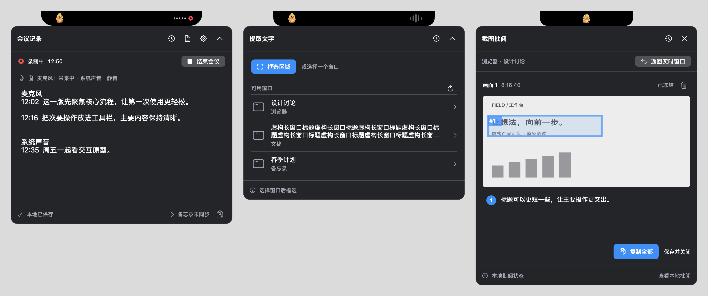

# A 原生极简实现验收 · 2026-11-05

依据用户已选择的 A，未采用 B/C 混搭。批准档案：`/Users/rexlv/Workspace/design-reviews/aisland-visual-20261105/DECISION.md`、`REVIEW.md`、`A-comparison.png`、`index.html`；实现前已读取并查看原尺寸图片。

实现提交 `2c74f4f`；集成 CI 提交 `94e4eda` 后的合并提交 `10666dd`。下列行为及构建命令均在合并后成功退出（0）；渲染对应相同原生视图源码。CI workflow、发布脚本和源码清单完整保留，无冲突。

## 实际原生图与 A 对照



[批准 A 图（本机稳定档案）](/Users/rexlv/Workspace/design-reviews/aisland-visual-20261105/A-comparison.png)

图片来自 NSHostingView / AppKit 实际生产视图，全部内容是测试 fixture；没有 HTML 嵌入，没有桌面截图、真实窗口采集或重复使用设计图。三场景合成图使用生产会议/读屏/批阅视图，批阅上方仅增加静态身份展示容器。PNG 为 Retina 2x；判断字号应按 point 尺寸查看，不能把整张合成图缩小后判断。

- 会议：494×484 pt，238 pt 转写阅读区，系统字 16 pt；来源按连续组展示，时间和原文保留，复制/导出的原始逐行来源不变。23 pt 小鸭、黑岛、石墨面板、细分隔、15 pt 圆角；物理刘海仍保留硬件避让宽度。
- 读屏：494 pt 宽，列表按数量收缩；主要字 14 pt、辅助字 12 pt。真实运行应用图标（无图标则系统窗口符号），没有模拟缩略图或新增后台采集。主动作“框选区域”，窗口模式及编辑/未保存保护沿用原流程。
- 批阅：494 pt 宽，最大 680 pt 高并按屏幕可用高度限制。截图与编号意见为主体；冻结预览支持直接拖动框选，原全尺寸冻结画布保留；底部复制和保存关闭常驻，撤销/选中删除按状态显示。会议录音时顶部退出入口留有空间，语音互斥沿用原模型。
- 历史和结果：统一石墨底色及系统字体，结果仍完整保留原文/总结/待办分区。
- 操作图标均有 tooltip/辅助名称；不以 emoji 充当操作图标，状态包含文字或符号，不只使用颜色。

### 覆盖截图

`meeting.png`、`reader.png`、`review.png` 为基本状态；`meeting-long-failure.png`、`meeting-empty.png`、`meeting-busy.png`、`reader-empty.png`、`reader-busy.png`、`reader-unsaved-meeting.png`、`review-edit-meeting.png`、`review-failure.png`、`review-busy.png`、`review-empty-recovery.png` 覆盖长内容/失败/空态/忙碌/会议与工具并用。

`meeting-settings.png`、`meeting-recovery.png`、`recent-records.png`、`result.png`、`recording-menu.png` 覆盖设置、恢复、历史、结果和显式结束入口。设置继续调用原 AI 授权函数，没有新增未实现的模型选择。错误原文和长路径只进入详情，不铺在主面板。

已逐张检查关键状态图片：按钮、底栏和两行长标题可读；长转写/结果/意见通过原生滚动容器显示。渲染函数断言实际 fittingSize 不超过提供尺寸；并测试来源展示压缩、未知文本保留和空列表高度。

## 验收命令（退出 0）

```sh
bash scripts/ci/test.sh
bash tests/run-review-recovery.sh
bash tests/run-integration-termination.sh
bash outputs/DuckIsland/Tests/run-predictable-actions.sh
bash outputs/DuckIsland/Tests/workflow/run.sh
bash tests/run-ux-render.sh "$PWD/tests/reports/native-a"
bash scripts/ci/build.sh /tmp/native-a-integrated-direct v0.0.0-dev
xcodebuild -project outputs/DuckIsland/DuckIsland.xcodeproj \
  -scheme DuckIsland -configuration Release \
  -derivedDataPath /tmp/native-a-integrated-store \
  CODE_SIGNING_ALLOWED=NO CODE_SIGNING_REQUIRED=NO build
git diff --check
```

CI 测试包含 7 个 Python 发布/版本测试、最近记录双配置测试、保存可靠性双配置测试、普通/APP_STORE/Helper 无签名编译及确定性双音源测试。额外行为回归验证退出三路保存屏障、旧会话隔离、超时保留尾段、重复结束幂等、OCR 未保存保护、批阅历史恢复/撤销、语音迟到回调归属和会议麦克风互斥。APP_STORE 分支无 CLI 分析路径；关闭 AI 不发送的原有测试保持通过。

普通 Release 通过 CI 脚本使用 `swiftc -O` 构建；APP_STORE Release 与嵌入 Helper 通过 Xcode 构建。曾尝试把 App Store Xcode 工程全局条件改为 LOCAL_BUILD，这会让专用 Helper 缺失分析实现，故改用项目正式直接分发脚本验证普通 Release，没有修改 Helper 架构。早期蓝色导出像素断言也发现磁盘 CGContext 导出仍为橙色，已将磁盘与富文本/预览统一为蓝色并回归通过。

## 安全范围与限制

测试未启动真实麦克风、真实语音识别、私人屏幕采集、Notes 同步或外部 AI，也未重置权限。实际多屏硬件与 VoiceOver 尚未实测；已有多屏坐标/归一化 fixture 测试通过。显示顺序和标签经原生视图检查，但这不等价于完整 VoiceOver 人工验收。批阅小尺寸屏幕的主体允许滚动，真实多屏/最小显示缩放仍建议人工体验。

本报告记录验收通过的代码与构建；远端交付 SHA、本机安装备份及签名/启动结果在交付记录中补充。
